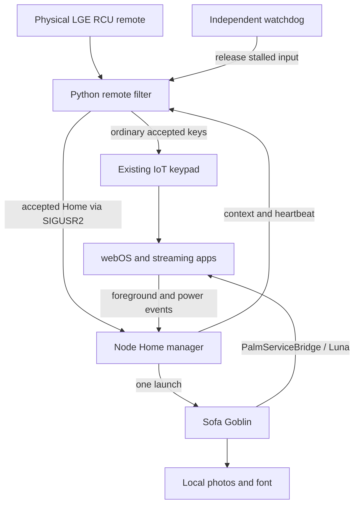

# Architecture

The web app and two optional helpers run on the TV. The computer only builds, previews, and installs.

## Web app

- `index.html`: header, photo area, tiles, controls, dialog, toast.
- `styles.css`: palette, static gradients, type, focus indicators.
- `app.js`: catalog, navigation, saved order, launch deduplication, dialogs, clock.
- `platform.js`: PalmServiceBridge requests, seven-second timeout, bridge cleanup. Browser preview never launches actual apps.
- `photos.js`: two local image layers, 30-second interval, hidden-page suspension. CSS respects reduced motion.
- `photos-config.js`: empty in source; the build generates a list from the private photo manifest.

Streaming apps own sign-in, playback, and history. Launcher preferences use local storage (`sofa-goblin.v1`; photo visibility has its own key). CSP allows local assets, including explicit `file:` URLs required by this TV. Browser network connections are disabled; Luna uses the TV bridge.

## Home manager

`home-manager.js` is Node 8-compatible, started by `50-sofa-goblin`; `flock` prevents duplicates. Its pure `Controller` separates policy from TV I/O for tests.

It subscribes to foreground-app and power events via `luna.js`. Startup waits six seconds; wake waits 1.5 seconds. Unintentional LG Home visits trigger redirection. Direct physical Home requests launch the app once; if already home, they do nothing.

The fallback requests LG overlay closure and launches once. LG's `no app matched by pid` close error is nonfatal. Do not restore the former launch-close-launch sequence that contributed to visible Home switching.

An explicit **LG Home → Open LG Home** action creates `/tmp/sofa-goblin-allow-lg-home`. The manager consumes a marker under 15 seconds old and allows LG Home until the viewer leaves it. Physical Home can return to Sofa Goblin.

Three consecutive launch failures stop automatic launching for that process and withdraw routing capability. Retry checks prevent a failed request from pulling the viewer out of a subsequently opened app. Context updates happen on app/power changes and every two seconds.

`luna.js` keeps the child `luna-send` stdin pipe open; on the tested firmware EOF otherwise terminates it before a response. Run the helper as a saved module/CLI file. Piping Node source through `node -` caused old-runtime assertions during development.

## Physical remote filter

`remote_guard.py` supports Python 2.7 on TV and Python 3 tests. It discovers **LGE RCU** and **IoT keypad** by name, checks capabilities, grabs the physical input with `EVIOCGRAB`, and mirrors accepted events to the existing keypad. It does not patch an LG binary or create an input driver.

In the five configured streaming apps, protected keys need a press, release, and second press within two seconds. Other keys cancel confirmation. Holding never confirms. Accepted non-Home actions emit one native tap; ordinary navigation/playback keys pass normally.

Accepted Home signals the manager instead of sending LG's native Home key. It requires fresh active context, enabled flags, advertised support, and a matching process identity. Outside streaming apps Home needs one press. Unavailable routing falls back to native input. Disabling the guard stops it and releases its grab.

The watchdog is forked before opening input descriptors. A four-second stall kills the filter and releases held forwarded keys. Context older than six seconds disables protection. Startup waits up to 30 seconds for devices; unsupported capabilities fail open. These protections do not establish compatibility with untested hardware.

## State and files

| TV path | Purpose |
| --- | --- |
| `/media/developer/apps/usr/palm/applications/com.sofagoblin.home/` | Installed app on tested TV |
| `/var/lib/sofa-goblin/` | Manager, Luna wrapper, filter, control script |
| `/var/lib/sofa-goblin/enabled` | Automatic Home enabled |
| `/var/lib/sofa-goblin/guard-enabled` | Filter enabled |
| `/var/lib/webosbrew/init.d/50-sofa-goblin` | Manager boot hook |
| `/var/lib/webosbrew/init.d/55-sofa-goblin-guard` | Filter boot hook |
| `/tmp/sofa-goblin-guard-context.json` | App/power/session heartbeat, routing capability |
| `/tmp/sofa-goblin.pid`, `/tmp/sofa-goblin-guard.pid` | Verified process identifiers |
| `/tmp/sofa-goblin.log`, `/tmp/sofa-goblin-guard.log` | Bounded operational logs |
| `/tmp/sofa-goblin-allow-lg-home` | One-use bypass marker |

Logs rotate above 128 KiB (Home) and 64 KiB (guard). They do not record account tokens or typed text, but protected-button decisions/app IDs should still be reviewed before public sharing.

## Build boundary

`build.mjs` copies the app, optionally adds JPEGs, and generates house icons. `ares-package` makes the IPK. `tv-control.mjs` separately manages root helpers over SSH using strict host verification and `.device/tv.json`.

Updating helpers does not update the IPK, and updating the IPK does not update helpers. No middleware or computer process participates during normal TV use.
